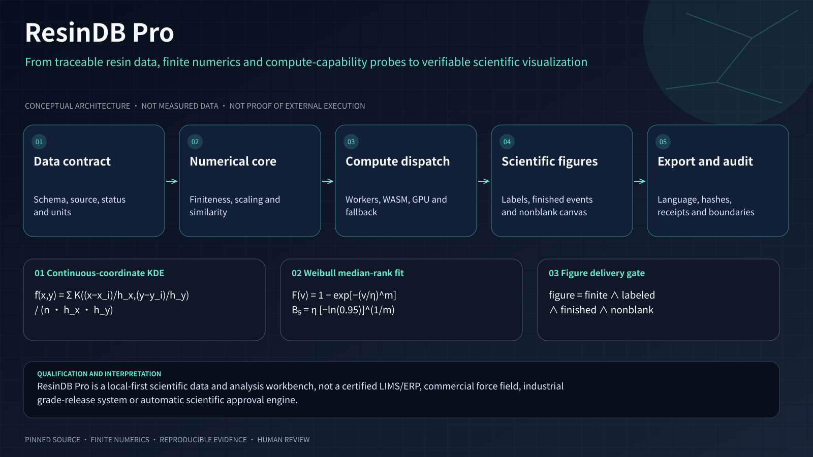

# ResinDB Pro by SunHJ

[中文](README.zh-CN.md) · [English](README.en.md)


ResinDB is a React / TypeScript materials-data and scientific-screening workspace with local IndexedDB storage, a configurable REST client, formula dependency graphs, unit checking, statistical screening and scientific charts. Its goal is to connect each number to its declaration and each calculation to a cohort, units, algorithm and limits. This repository delivers the browser application and computation modules; remote authentication/database servers and real material measurements require separate provision.


The AI-designed image illustrates the project vision. Its text and equations explain the concept; it is not an experimental result or acceptance screenshot. Implemented behavior is described below and must be checked against execution evidence.




## Install and run

```bash
nvm install
nvm use
npm ci
npm run dev -- --host 127.0.0.1
```

Use Node 22.23.3 from `.nvmrc` (engine range >=22.13.0 <23). The initial demo workspace contains 13 demo records; always review the live count. KaTeX and its fonts are bundled locally, without a formula CDN. Build with `npm run build` and inspect with `npm run preview`; deployment settings are in [.env.example](.env.example).

## Working strategy

1. Establish data identity, source, license and confidentiality. Distinguish DEMO / SYNTHETIC / MEASURED / IMPORTED records.
2. After import, verify fields, units, methods, temperature and load. Flat CSV units must be declared in source headers; property names do not supply units.
3. After edits or batch updates, inspect refreshed quantity states. Resolve UNKNOWN / INVALID reasons before analysis.
4. Declare every formula output unit; enter `1` for dimensionless output. Use Test to inspect status before saving the dependency graph.
5. Select valid X/Y properties and inspect the eligible-point count before clustering, Pareto, TOPSIS or Mahalanobis screening.
6. Record conditions, seeds, normalization, cohorts and exclusions; compare exported records with their original declarations.

## Mathematical methods and scientific boundaries

### Strict quantities and units

$$
q_{\mathrm{can}}=s_u q_{\mathrm{raw}},\qquad q_{\mathrm{raw}},q_{\mathrm{can}}\in\mathbb{R}_{\mathrm{finite}}
$$

Complete decimal/scientific-notation parsing rejects `12abc`, hexadecimal text, empty values, infinity and nonzero underflow. Raw text, units, methods, temperature, load and provenance remain in the quantity record. Canonical units come from the property registry (for example g/cm³ for density and MPa for stress); the formula module applies a separate SI dimensional scaling. Only finite VALID canonical values are admitted. UNKNOWN/INVALID records cannot regain eligibility through raw values; missing units are never guessed. Core and formula unit symbols are case-sensitive: unsupported mPa is never reinterpreted as MPa.

### Dimensional propagation

$$
\begin{aligned}
\mathbf{d}(q)&=(a,b,c,d),\qquad [q]=M^aL^bT^c\Theta^d \\
\mathbf{d}(xy)&=\mathbf{d}(x)+\mathbf{d}(y),\qquad \mathbf{d}(x/y)=\mathbf{d}(x)-\mathbf{d}(y) \\
x+y&\text{ requires }\mathbf{d}(x)=\mathbf{d}(y)
\end{aligned}
$$

Four SI exponent components propagate through the dependency graph. Addition/subtraction require matching dimensions; multiplication/division combine dimensions. Exponents and log/exp/trigonometric arguments must be dimensionless. The bounded parser does not execute arbitrary JavaScript. Compatible inputs are converted before calculation: 25 MPa + 0.1 GPa produces 0.125 GPa.

### Specific strength

$$
\sigma_s=\frac{\sigma_y}{\rho},\qquad [\sigma_s]=\mathrm{MPa\,cm^3/g}
$$

Use tensile yield stress divided by density. Tensile break stress is not automatically substituted for yield stress, and missing inputs are not replaced by zero or one. Inputs need comparable material and test states; this ratio does not authorize structural use.

### Specific modulus

$$
E_s=\frac{E_f}{\rho},\qquad [E_s]=\mathrm{MPa\,cm^3/g}
$$

Use flexural modulus and density. The bounded registry supports Pa/kPa/MPa/GPa, g/cm³/kg/m³ and this compound output unit. Legacy records without units may calculate as NUMERIC_ONLY; they cannot claim DIMENSION_CHECKED. Mixed typed and untyped inputs return UNKNOWN.

### Descriptive impact–stiffness product

$$
I_{CE}=\frac{a_{\mathrm{Charpy}}E_f}{10000},\qquad [I_{CE}]=\mathrm{MPa\,kJ/m^2}
$$

The historical default retains its ÷10000 scale while correcting the output unit. Migration requires an exact match of the preset ID, name, old expression and unit and preserves history; custom formulas are untouched. Charpy and Izod are distinct tests. This product is not a certified toughness score.

### TOPSIS screening

$$
r_{ij}=\frac{x_{ij}-\min_i x_{ij}}{\max_i x_{ij}-\min_i x_{ij}},\quad v_{ij}=w_jr_{ij},\quad C_i=\frac{D_i^-}{D_i^++D_i^-}
$$

Cost criteria reverse direction. Weights are scaled before normalization; values are scaled before range subtraction and distances use stable hypot. Missing observations are excluded by default; explicit imputation requires a value and provenance. With no criteria there is no ranking or top three. Eligible rows with only constant criteria receive neutral 0.5, meaning no discrimination.

### Radar profiles

$$
z_j=20+80\frac{n_{<j}+\tfrac12n_{=j}}{n_j}
$$

The scientific radar shows within-cohort midranks on shared finite properties, requiring at least three shared axes. Mapping to 20–100 is a display convention. Axis values and polygon area do not measure quality, balance or an all-round grade. Insufficient data remains unavailable rather than being filled with zeros.

### Paired scatter and principal components

$$
\mathcal{S}_{xy}=\{i:x_i,y_i\in\mathbb{R}_{\mathrm{finite}}\},\quad X_c=X-\bar X,\quad Z=X_cW_k
$$

Default axes use actual Density / MFR property keys. Canvas, K-Means and Pareto share the same finite paired cohort; unrelated sparse properties do not erase ordinary scatter points. Axis/cohort changes clear previous clusters/frontiers and cancel old workers. PCA uses complete cases and a global maximum-absolute scaling step, not per-feature standardization; design features carefully before comparing mixed units.

Correlation reports use the sign of Pearson r for direction and |r| for the magnitude of association in the current sample. R² is the coefficient of determination, not a confidence level. Skewness describes sample asymmetry; zero skewness does not establish normality. P-values and slope intervals depend on sampling and model assumptions. Significant correlation does not establish causality, a physical mechanism or inverse-formulation capability; prediction error requires validation on independent data.

### Clustering and Pareto screening

$$
\min_{\mu,c}\sum_i\|x_i-\mu_{c_i}\|_2^2,\qquad x\prec y\iff(\forall j:x_j\le y_j)\land(\exists j:x_j<y_j)
$$

K-Means receives the current eligible cohort and distinct selected axes, not a union of sparse properties with imputed zeros. Pareto screening follows objective directions and avoids duplicated X/Y objectives. The local runtime benchmark measures TS/WASM execution paths; it is not instrument or material calibration. Preserve seeds, backend decisions and actual cohort sizes with analysis.

### Mahalanobis screening

$$
D_M^2=(x-\mu)^T\Sigma_\lambda^{-1}(x-\mu),\qquad n_{\mathrm{complete}}>p
$$

Exclude incomplete or invalid rows before checking that the complete-case count n strictly exceeds feature count p. The core uses regularization and factorization-based solves. The UI reports actual n/p. Being below the threshold only means the selected statistical rule did not flag the sample.

### Carreau–Yasuda rheology proxy

$$
\eta(\dot\gamma)=\eta_\infty+(\eta_0-\eta_\infty)\left[1+(\lambda\dot\gamma)^a\right]^{(n-1)/a}
$$

The current rheology interface generates deterministic proxy points from an MFR rule, then performs bounded fitting. It does not measure a shear curve. A positive finite MFR is required; missing values do not default to 5. Proxy points, fitted models and observations are labeled separately, with positive-domain, log-axis and export checks.

### Temperature shift and activation relations

$$
\log_{10}a_T=-\frac{C_1(T-T_r)}{C_2+T-T_r},\qquad \ln k=\ln A-\frac{E_a}{RT}
$$

WLF and Arrhenius have dedicated computation modules with explicit reference temperatures and domains. Celsius values cannot be treated as Kelvin. The formula editor’s bounded unit registry is not a general-purpose unit algebra. Preserve inputs and inspect fit residuals. The local Carreau/WLF/Weibull sandbox rejects blank, non-finite, out-of-domain, and unrepresentable inputs/results instead of silently clamping parameters.

### Thermal kinetics

$$
\ln\!\left(\frac{\beta}{T_p^2}\right)=\ln\!\left(\frac{AR}{E_a}\right)-\frac{E_a}{RT_p}
$$

Kissinger analysis needs multiple heating rates and corresponding absolute peak temperatures. Its linear relation has model assumptions; fitting does not establish a reaction mechanism or process window. Invalid domains, degenerate observations and insufficient data must follow module errors.

### Weibull and Prony models

$$
F(x)=1-e^{-(x/\eta)^m},\quad x>0;\qquad E(t)=E_\infty+\sum_jE_je^{-t/\tau_j}
$$

Weibull shape, scale and its 63.2% quantile describe the supplied domain; they are not manufacturing certification. Prony modes describe the selected data and time domain. Extrapolation and service-life conclusions need additional measurements.

### Uncertainty simulation

$$
\begin{aligned}
X_j^{(b)}&\sim\mathcal N(\mu_j,\sigma_j^2),\qquad \sigma_j=|\mu_j|p_j/100\\
Y^{(b)}&=f(X^{(b)}),\qquad I_{0.90}=[Q_{0.05}(Y),Q_{0.95}(Y)]
\end{aligned}
$$

Monte Carlo samples independent normal inputs; the percentage control specifies standard deviation relative to the absolute input mean. It returns empirical simulation quantiles, not a confidence interval for model parameters. Record the input standard deviations, draw count and seed; this implementation does not infer input correlations. Simulation and deterministic TEST share the same unit-aware formula evaluator, including derived dependencies: zero-variance density `0.958 g/cm³` returns `958 kg/m³` in both paths. Fixed unit/admission metadata and reusable dictionaries prevent stale canonical values without cloning a product per draw. Scaled compensated reductions keep representable statistics finite; an unrepresentable statistic or KDE domain returns an error. Changing formulas, output units, dependencies, the sample or its variability invalidates earlier results. Simulation does not replace physical testing.

### Density estimation and Gaussian Process

$$
\hat f_h(x)=\frac1{nh}\sum_iK\!\left(\frac{x-x_i}{h}\right),\qquad \mu_*=k_*^T(K+\sigma_n^2I)^{-1}y
$$

KDE smoothing depends on bandwidth. Gaussian Process, Bayesian optimization, multiobjective surrogates and response surfaces produce model predictions; acquisition candidates are not validated formulations. Regularization and finite-cohort checks handle numerical issues, not sampling bias.

### Copula probability and the display grid

$$
\widehat F_X(t)=\frac1n\sum_{i=1}^n\mathbf1\{x_i\le t\},\qquad
P(X\le x,Y\le y)=C_\rho\!\left(\widehat F_X(x),\widehat F_Y(y)\right)
$$

The worker assigns average ranks to ties, forms pseudo-observations $(r_i-0.5)/n$, transforms them to normal scores and estimates their correlation. The density model limits correlation to $[-0.999,0.999]$. Threshold probabilities use the inclusive empirical CDF, including ties; thresholds above the sample return the complete margin. The independent comparison uses the same ECDF.

For $0<u,v<1$ and $|\rho|<1$, let $a=\Phi^{-1}(u)$ and $b=\Phi^{-1}(v)$. The code evaluates

$$
C_\rho(u,v)=uv+\frac1{2\pi}\int_0^{\arcsin\rho}
\exp\!\left[-\frac{(a-b)^2}{4(1-\sin\theta)}-\frac{(a+b)^2}{4(1+\sin\theta)}\right]\,d\theta.
$$

`src/compute/gaussianCopula.ts` applies an angle substitution to [Plackett's correlation derivative](https://doi.org/10.1093/biomet/41.3-4.351), then uses bounded adaptive Simpson quadrature. Independence, probability boundaries and perfect-correlation limits are handled separately. Thus $C(u,1)=u$, $C(1,v)=v$, $C(1,1)=1$ and $C_0(u,v)=uv$, with numerical output respecting the Fréchet bounds. The density grid is used only for display; changing its resolution cannot change a threshold probability. Regressions compare the analytic median-quadrant identity and independent conditional-normal quadrature reference values. Results estimate the fitted dependence model, not measured failure rates or causality. Tail inference remains limited by the sample and marginal assumptions.

### Continuous response surfaces and layers

$$
\widehat y=\beta_0+\beta_1x_1+\beta_2x_2+\beta_{11}x_1^2+\beta_{22}x_2^2+\beta_{12}x_1x_2,\qquad
\begin{bmatrix}2\beta_{11}&\beta_{12}\\\beta_{12}&2\beta_{22}\end{bmatrix}x_*=-\begin{bmatrix}\beta_1\\\beta_2\end{bmatrix}.
$$

RSM preserves signed responses and physical coordinates. Copula and RSM render bounded custom color cells whose boundaries lie halfway between adjacent grid centers. Continuous `value` axes no longer use ECharts' category-only `heatmap` series. Observations and stationary points have distinct marker layers; the color map applies only to model cells. A single coordinate cannot define a cell width and yields the no-plottable-data state. The RSM grid extends each observed range by 20% at either end; those regions remain model extrapolation. A stationary point can lie outside the observations or be a saddle; the UI does not automatically claim an optimal formulation.

### Jansen variance sensitivity

$$
\widehat S_{T,j}=\frac{\sum_{i=1}^{N}[f(A_i)-f(A_{B,i}^{(j)})]^2}{2N\widehat V},\qquad
\widehat S_{1,j}=1-\frac{\sum_{i=1}^{N}[f(B_i)-f(A_{B,i}^{(j)})]^2}{2N\widehat V}.
$$

$A_B^{(j)}$ replaces column j of A with column j of B. The worker uses independent pseudo-random normal Saltelli A/B samples with its implemented input bounds; it does not implement a Sobol low-discrepancy sequence. Numerically zero output variance is an error. Displayed estimates are nonnegative, with first order no greater than total effect. $S_T-S_1$ is aggregate higher-order contribution, not a particular pairwise interaction or causal effect.

### Relative sensitivity and reviewable evidence

$$
S_{yx}\approx\frac{f(x+\delta x)-f(x-\delta x)}{2\delta x}\frac{x}{f(x)}
$$

Dependency heatmaps perturb copied admitted quantities using finite differences and preserve source records. Formula outputs and rule-generated proxies are labeled separately. Zero input/output baselines, rejected quantities and unavailable dependencies remain unavailable. Software tests and data audits establish software checks, not material certification.

## Bilingual figure workflow and validation

Advanced figure titles, subtitles, legends, tooltips, axis descriptions and accessibility descriptions regenerate when the language changes. ECharts' built-in locale and Save as image control switch with it. User-supplied material names remain unchanged; registered properties use the property translation map. Equations, units and proper names may remain common to both languages. Real ECharts SVG regressions cover Copula, RSM, Sobol, Mahalanobis, similarity networks, WLF, Pareto, Prony, SPC, ridge attribution, Arrhenius, Kissinger, Bayesian models and degradation scenarios in both languages.

For acceptance, open Copula or RSM in Scientific Visualization, calculate from finite paired or triple observations, switch between Chinese and English, and hover over model cells. The real Chromium suite checks nonempty native Canvas pixels, text actually drawn, hover tooltips and accessibility language, and captures both locales. SVG SSR tests run in Node and validate real ECharts options; they do not establish browser Canvas behavior or installed CJK font rendering. The browser suites test those paths without substituting mocked Canvas drawing.

## Separate data and code layers

`data/resins/` contains versioned declarations and taxonomy, governed by `data/manifest.json` and data validators. `src/lib/quantityRecord.ts` defines quantity boundaries; `src/lib/propertyAdmission.ts` centralizes admission and recanonicalization after edits. `src/lib/formula/` and `formulaParser.ts` implement parsing, dimensions and dependency execution. `src/compute/`, `src/workers/` and `src/hooks/workers/` separate kernels, messages and React lifecycle. See [docs/compute-module-catalog.json](docs/compute-module-catalog.json).

### Import, editing and backend boundaries

JSON import/export preserves complete Product records. CSV includes `GovernanceJSON`, `PropertiesJSON` and `RecordJSON` for structured round trips. XML escapes values and includes property Metadata and Governance; the import UI supports JSON/CSV/TXT and does not promise automatic XML import. Corrupt structured input is rejected instead of flattened into a record with missing units. Merges retain the stricter confidentiality, mark mixed sources UNKNOWN and set NOT_FOR_RELEASE. Unchanged edit fields preserve method, load, sampleId, batchId and provenanceRefs; changed quantities are recanonicalized.

Manual entry and file import both reach a preview before persistence. Completion is shown only after the adapter confirms success. Local imports apply inserts and updates in one IndexedDB transaction and update caches after commit. Remote imports use the existing update/create endpoints; a backend transaction spanning those requests is not assumed. A failed remote sequence remains visible and attempts to reconcile persisted records.

IndexedDB provides local persistence; the REST adapter is a client contract. Remote-read fallback must be explicitly enabled; failed remote writes never silently write locally. AI egress has separate governance checks. Interpret presets, proxies and generated suggestions according to their sources.

## Acceptance, tests and delivery decisions

```bash
npm run validate:ci
npm audit --omit=dev --audit-level=high
npm ls --all
node --test scripts/tests/*.node.mjs
```

`validate:ci` runs docs/Unicode/source/scientific-UI/compute/data contracts, ESLint, TypeScript, Vitest, build and smoke, K-Means benchmark smoke, grouped tests, coverage, three Chromium UI suites and the full dependency audit. Original thresholds remain in configuration: passing requires real checks, not reduced coverage gates, hidden failures or empty test substitutes. Browser acceptance needs executable Chromium (`CHROME_BIN`) and Chinese/English fonts. A canvas element alone does not establish rendered data; scatter evidence must inspect real pixels and eligible-point counts.

The lockfile pins DOMPurify 3.4.17, the patched release for [GHSA-cg2g-xh64-v4q7](https://github.com/advisories/GHSA-cg2g-xh64-v4q7) and [GHSA-mrv2-3pqr-j5jr](https://github.com/advisories/GHSA-mrv2-3pqr-j5jr); the dependency candidate workflow uses the same version. Rerun production and complete dependency audits for every delivery. A version pin does not replace current vulnerability checks.

Reports and coverage are generated in local `artifacts/` and `coverage/`. Every result belongs to a particular source revision and environment. Delivery must verify the exact GitHub main commit and its Actions result; old results do not certify new code. A six-hour run requires real timestamps and logs, not a README assertion. See the [validation contract](docs/VALIDATION.md).

## Implemented scope and next steps

The current scope is traceable materials screening, numerical boundaries, local persistence and reviewable scientific displays. Units use a finite registry: general compound-unit grammar, affine Celsius conversion, full mol/eq chemical dimensions and automatic experimental certification are not implemented. Safety-critical selection, compliance and service-life conclusions require independent experiments and domain review. The next-stage vision is to connect real measurements, explicit interfaces and versioned evidence; artwork does not demonstrate implementation.

The [historical image archive](README.visual-archive.md) preserves earlier UI screenshots and concept diagrams with explicit historical labels. They are not evidence from the current execution.
