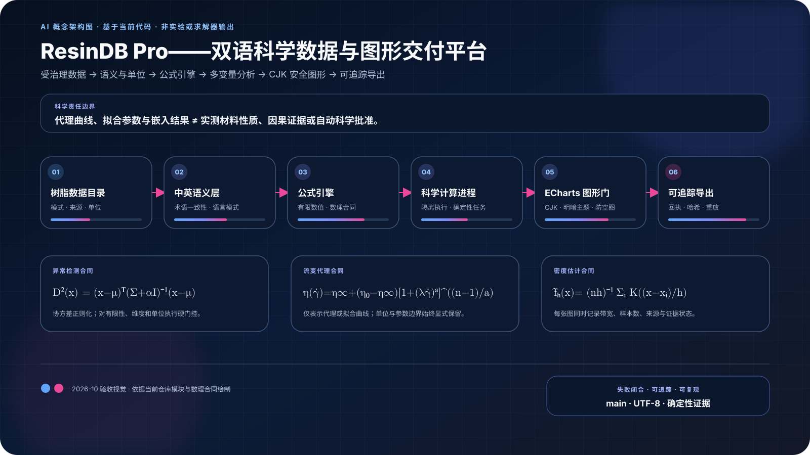
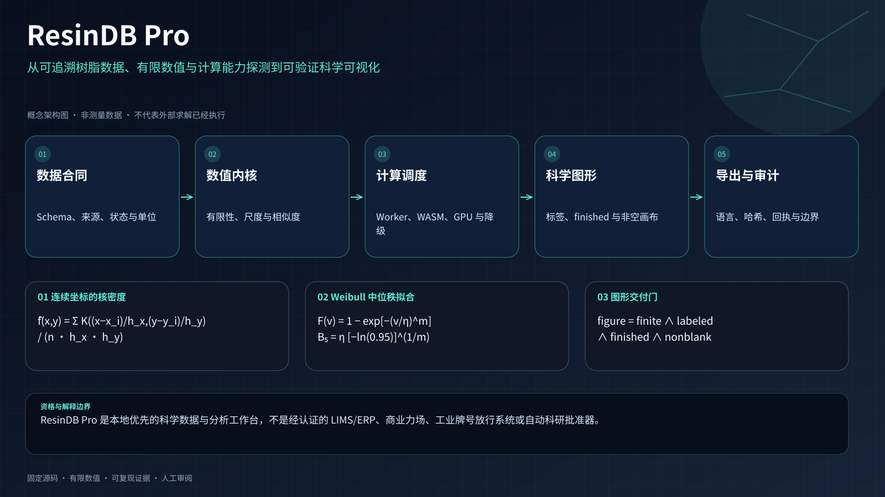

# ResinDB Pro by SunHJ

[中文](README.zh-CN.md) · [English](README.en.md)


ResinDB 是 React / TypeScript 材料数据与科研筛选工作区，提供本地 IndexedDB 数据管理、可配置 REST 客户端、公式依赖图、单位检查、统计筛选和多种科学图表。目标是让每个数字能够追溯到原始声明，让每次计算说明样本、单位、算法与限制。当前仓库交付浏览器应用及计算模块；远程鉴权、数据库服务器和真实材料测量需要独立部署或提供。


上图为 AI 设计的愿景示意；其文字与公式用于解释方向，不代表实验结果或验收截图。实际功能以以下代码说明和运行结果为准。





## 安装与运行

```bash
nvm install
nvm use
npm ci
npm run dev -- --host 127.0.0.1
```

使用 `.nvmrc` 指定的 Node 22.23.3（引擎范围 >=22.13.0 <23）。首次进入演示工作区显示 13 条演示记录，实际数量始终以界面为准。KaTeX 与字体随本地构建打包，不依赖外部公式 CDN。生产构建运行 `npm run build`，用 `npm run preview` 预览；部署设置参见 [.env.example](.env.example)。

## 使用策略

1. 先确认数据身份、来源、许可证与保密级别，区分 DEMO / SYNTHETIC / MEASURED / IMPORTED。
2. 导入后核对原始字段、单位、方法、温度和载荷；平面 CSV 的单位必须出现在源表头声明中，不从属性名猜测。
3. 编辑样本或批量修改后查看重建的 quantity 状态；UNKNOWN / INVALID 先解决原因再分析。
4. 新建公式声明输出单位；无量纲明确填 `1`。先用“测试”查看状态，再保存依赖图。
5. 选择实际有效的 X/Y 属性；查看散点的有效样本数，再运行聚类、Pareto、TOPSIS 或 Mahalanobis。
6. 记录条件、随机种子、归一化、输入集合和排除原因；导出后与原始记录复核。

## 数理程式与科学边界

### 严格数量与单位

$$
q_{\mathrm{can}}=s_u q_{\mathrm{raw}},\qquad q_{\mathrm{raw}},q_{\mathrm{can}}\in\mathbb{R}_{\mathrm{finite}}
$$

完整十进制/科学记数法解析拒绝 `12abc`、十六进制、空值、无穷和非零下溢。原始字符串、单位、测试方法、温度、载荷与溯源保存于数量记录；canonical 单位由属性注册表定义（例如密度为 g/cm³、应力为 MPa）；公式模块另行执行 SI 量纲缩放。只有 VALID 的有限 canonical 值进入计算。UNKNOWN/INVALID 不通过 raw 值重新获准。没有单位不猜测默认单位。核心数量与公式单位符号区分大小写；不支持的 mPa 不会被解释为 MPa。

### 量纲传播

$$
\begin{aligned}
\mathbf{d}(q)&=(a,b,c,d),\qquad [q]=M^aL^bT^c\Theta^d \\
\mathbf{d}(xy)&=\mathbf{d}(x)+\mathbf{d}(y),\qquad \mathbf{d}(x/y)=\mathbf{d}(x)-\mathbf{d}(y) \\
x+y&\text{ 要求 }\mathbf{d}(x)=\mathbf{d}(y)
\end{aligned}
$$

四维 SI 指数向量跟随依赖图传播；加减要求同维，乘除组合维度，指数与 log/exp/三角函数参数须无量纲。受限解析器不执行任意 JavaScript。兼容输入先换算，结果再换成声明的输出单位；25 MPa + 0.1 GPa 输出为 0.125 GPa。

### 比强度

$$
\sigma_s=\frac{\sigma_y}{\rho},\qquad [\sigma_s]=\mathrm{MPa\,cm^3/g}
$$

使用 `拉伸屈服应力 / 密度`，不把 tensile break 当作 tensile yield，不用 0 或 1 填补缺失。两项须对应可比较的材料及测试状态；比强度不是结构件安全许可。

### 比模量

$$
E_s=\frac{E_f}{\rho},\qquad [E_s]=\mathrm{MPa\,cm^3/g}
$$

使用弯曲模量与密度。单位注册表支持 Pa/kPa/MPa/GPa、g/cm³/kg/m³，以及这里的输出复合单位。未声明单位的旧记录可做 NUMERIC_ONLY 运算，但不得宣称 DIMENSION_CHECKED。混合有单位与无单位输入返回 UNKNOWN。

### 冲击与刚度描述性乘积

$$
I_{CE}=\frac{a_{\mathrm{Charpy}}E_f}{10000},\qquad [I_{CE}]=\mathrm{MPa\,kJ/m^2}
$$

默认历史指标保留 ÷10000 比例并改正输出单位。只迁移 ID、名称、旧公式、旧单位完全匹配的内置默认项，并保留历史；用户自定义公式不被覆盖。Charpy 与 Izod 为不同试验，不作别名互换，也不把此乘积称为认证韧性评分。

### TOPSIS 筛选

$$
r_{ij}=\frac{x_{ij}-\min_i x_{ij}}{\max_i x_{ij}-\min_i x_{ij}},\quad v_{ij}=w_jr_{ij},\quad C_i=\frac{D_i^-}{D_i^++D_i^-}
$$

成本型指标翻转方向。权重先按最大值缩放再归一化，数值先缩放后计算极差，距离采用稳定 hypot。缺失默认排除，显式插补须声明数值和溯源；没有指标时没有排名、没有前三名。全常数指标中合格候选得到中性 0.5，表示无法区分。

### 雷达轮廓

$$
z_j=20+80\frac{n_{<j}+\tfrac12n_{=j}}{n_j}
$$

科研雷达在当前候选的共同有限属性上显示组内 midrank；至少三个共同轴。20–100 映射为视觉展示约定。坐标值与多边形面积不代表质量、均衡分或全能等级。没有足够有效轴时显示不可用，不补零。

### 成对散点与主成分

$$
\mathcal{S}_{xy}=\{i:x_i,y_i\in\mathbb{R}_{\mathrm{finite}}\},\quad X_c=X-\bar X,\quad Z=X_cW_k
$$

默认坐标为真实字段“密度 / 熔体质量流动速率”。Canvas、K-Means 和 Pareto 复用同一成对有效样本；其他稀疏属性不使普通散点消失。更换坐标或样本会清除旧聚类/前沿并取消旧 Worker。PCA 使用完整案例，先做全矩阵最大绝对值缩放；这不等于逐特征标准化，跨单位解释前须人工设计特征。

相关报告按 Pearson r 的符号显示正负方向，以 |r| 描述当前样本的关联强度；R² 是决定系数，不是置信度。偏度只作为样本不对称性的描述，零偏度不能确认正态分布。p 值与斜率区间依赖抽样及模型假设；显著相关不确认因果、物理机理或配方反推能力，预测误差须用独立数据核验。

### 聚类与帕累托

$$
\min_{\mu,c}\sum_i\|x_i-\mu_{c_i}\|_2^2,\qquad x\prec y\iff(\forall j:x_j\le y_j)\land(\exists j:x_j<y_j)
$$

K-Means 的实际工作量来自当前有效样本与去重坐标，不来自属性并集，也不补齐缺失。前沿依照各目标方向判断非支配；相同 X/Y 不重复建立目标。本机运行基准测量 TS/WASM 执行路径，不是仪器或材料校准。随机种子、后端选择和实际样本数须随分析保存。

### Mahalanobis 筛查

$$
D_M^2=(x-\mu)^T\Sigma_\lambda^{-1}(x-\mu),\qquad n_{\mathrm{complete}}>p
$$

先排除缺失/无效属性，再检查有效记录数 n 是否严格大于特征数 p。核心采用正则化与分解求解，界面报告实际 n/p；未超阈值只表示没有被该统计规则标记，不证明材料物理有效。

### Carreau–Yasuda 流变代理

$$
\eta(\dot\gamma)=\eta_\infty+(\eta_0-\eta_\infty)\left[1+(\lambda\dot\gamma)^a\right]^{(n-1)/a}
$$

当前流变界面由 MFR 规则生成确定性代理点，再做有界拟合，未测量真实剪切曲线。必须有正有限 MFR；缺失时不默认为 5。代理点、拟合与原始观测分开标识；正值筛选、对数坐标及导出范围均有门禁。

### 温移与活化关系

$$
\log_{10}a_T=-\frac{C_1(T-T_r)}{C_2+T-T_r},\qquad \ln k=\ln A-\frac{E_a}{RT}
$$

WLF 与 Arrhenius 位于独立计算模块；温度基准、量纲与有效域由对应入口决定。不能将摄氏数直接当开尔文，不能把公式编辑器有限单位注册表当通用单位代数。拟合须保留输入和残差检查。本地 Carreau/WLF/Weibull 沙箱拒绝空值、非有限数、域外参数与无法表示的结果，不会静默夹取参数。

### 热分析动力学

$$
\ln\!\left(\frac{\beta}{T_p^2}\right)=\ln\!\left(\frac{AR}{E_a}\right)-\frac{E_a}{RT_p}
$$

Kissinger 分析依赖多个升温速率与对应绝对峰温。其线性关系有模型假设，不通过曲线拟合自动确认反应机理或实际工艺窗口。负数、重复退化条件和不足观测应按模块错误处理。

### Weibull 与 Prony

$$
F(x)=1-e^{-(x/\eta)^m},\quad x>0;\qquad E(t)=E_\infty+\sum_jE_je^{-t/\tau_j}
$$

Weibull 形状、尺度及 63.2% 分位有输入域含义，不是制造质量认证。Prony 模态参数描述指定数据及时间域；外推与寿命结论需要额外测量依据。

### 不确定性模拟

$$
\begin{aligned}
X_j^{(b)}&\sim\mathcal N(\mu_j,\sigma_j^2),\qquad \sigma_j=|\mu_j|p_j/100\\
Y^{(b)}&=f(X^{(b)}),\qquad I_{0.90}=[Q_{0.05}(Y),Q_{0.95}(Y)]
\end{aligned}
$$

Monte Carlo 按独立正态分布抽样，百分比控件表示相对于输入均值绝对值的标准差。输出是经验模拟分位区间，不是参数置信区间；应记录输入标准差、抽样次数和随机种子，本实现不推断输入相关性。模拟与确定性“测试”共享量纲公式执行器，包括派生公式依赖：密度 `0.958 g/cm³` 在零方差时，两条路径均输出 `958 kg/m³`。每次请求绑定单位与数量资格，并复用数值字典，避免旧 canonical 数值覆盖抽样，也不逐次深拷贝材料记录。统计量采用量级缩放与补偿归约；不可表示的统计量或 KDE 绘图区间明确报错。改变公式、输出单位、依赖、样本或输入标准差，会作废旧结果。模拟不替代真实试验。

### 核密度与高斯过程

$$
\hat f_h(x)=\frac1{nh}\sum_iK\!\left(\frac{x-x_i}{h}\right),\qquad \mu_*=k_*^T(K+\sigma_n^2I)^{-1}y
$$

KDE 平滑程度取决于带宽。Gaussian Process、贝叶斯优化、多目标代理及响应面输出都是模型预测；采集候选不是已验证配方。核矩阵正则化与有效样本检查只处理数值问题，不消除样本偏差。

### 相对灵敏度与可复核证据

$$
S_{yx}\approx\frac{f(x+\delta x)-f(x-\delta x)}{2\delta x}\frac{x}{f(x)}
$$

依赖热图对拷贝后的有效数量做有限差分扰动，保留原记录；公式输出与规则代理分别标记。x=0、输出为 0、无效数量或不可计算依赖显示不可用。代码测试与数据审计是软件验收证据，不是材料性能认证。

## 数据层与代码层分离

`data/resins/` 保存版本化声明和分类树，`data/manifest.json` 与数据校验脚本维护数据契约；`src/lib/quantityRecord.ts` 定义数量边界。`src/lib/propertyAdmission.ts` 统一计算准入和编辑后重建；`src/lib/formula/` 与 `formulaParser.ts` 维护解析、量纲和依赖执行。`src/compute/`、`src/workers/`、`src/hooks/workers/` 分离核函数、消息与 React 生命周期。模块清单见 [docs/compute-module-catalog.json](docs/compute-module-catalog.json)。

### 导入、编辑与后端边界

JSON 导入/导出保留完整 Product；CSV 另含 `GovernanceJSON`、`PropertiesJSON`、`RecordJSON`，供原生结构往返；XML 进行转义并携带属性 Metadata 和 Governance，当前导入入口支持 JSON/CSV/TXT，不承诺 XML 自动导入。结构化输入损坏时拒绝，不能降级成丢失单位的平面记录。合并使用较严格保密级别，混合来源保留 UNKNOWN，并设置 NOT_FOR_RELEASE。编辑未改字段保留 method、load、sampleId、batchId、provenanceRefs；已改数量重新计算状态。

IndexedDB 是本地持久化后端；REST 适配器是客户端契约。远程读取回退必须显式启用，远程写入失败不会悄悄写到本地。AI 数据外发有独立治理检查；预置内容、规则代理和生成建议均需按其来源解读。

手动录入与文件导入都先进入预览，适配器确认保存后才显示完成。本地导入在一个 IndexedDB 事务中新增或更新记录，提交后更新缓存。远程导入沿用现有更新/新增接口，不假定后端提供跨请求事务；失败会明确显示并尝试重新读取已保存记录。

## 验收、测试与可交付判断

```bash
npm run validate:ci
npm audit --omit=dev --audit-level=high
npm ls --all
node --test scripts/tests/*.node.mjs
```

`validate:ci` 执行文档/Unicode/源代码/科学 UI/计算/数据契约、ESLint、TypeScript、Vitest、构建及 smoke、K-Means 基准 smoke、分类测试、覆盖率、三个 Chromium 界面套件与完整依赖安全审计。门槛定义留在原配置中，不通过降低覆盖率、隐藏失败或替换空测试制造通过。浏览器验收需要可执行 Chromium（可设置 `CHROME_BIN`）及可用中英文字体；只有 canvas 元素存在不足以证明图已画出，散点须验证真实像素与有效点数。

报告和覆盖率写入本地 `artifacts/`、`coverage/`；每次结果对应具体代码和运行环境。最终交付应核对 GitHub main 的确切提交及该提交 Actions 结果，不能把旧提交结果充当新代码验收。六小时运行只能按真实起止时间与日志认定，README 不预先宣称完成时长。详见 [验收契约](docs/VALIDATION.md)。

## 已实现范围与后续愿景

当前聚焦可追溯材料筛选、数值边界、局部持久化和可复核科学展示。单位系统是有限注册表：未实现通用复合单位语法、摄氏仿射转换、化学计量 mol/eq 全维度或自动实验认证。安全材料选型、法规合规与寿命结论需要独立试验和领域审查。下一步愿景是用真实测量、明确接口和可版本化证据扩展计算闭环，而不是把愿景图当作功能证明。

[历史图像归档](README.visual-archive.md) 保留旧版界面截图与旧概念图；其标签明确说明并非本次运行证据。
