# 历史图像归档 / Historical visual archive

以下是此前版本保存的界面与设计材料，保留供历史追踪；不是本次代码运行或验收证据。部分旧图为英文或双语，当前中文、英文主 README 分别展示自己的语言设计图。

These retained UI screenshots and concept diagrams describe earlier versions. They are historical reference, not evidence for the current source tree.

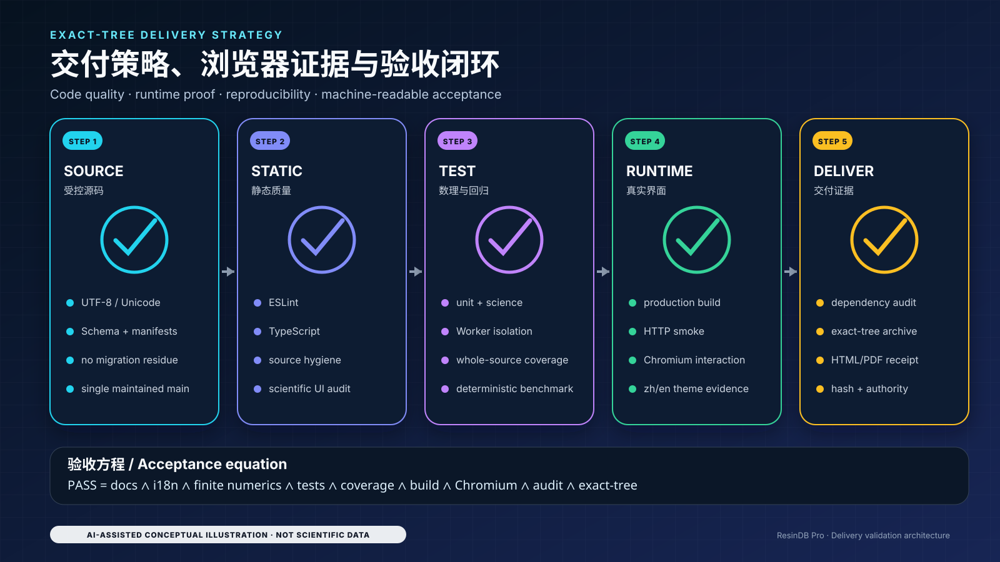

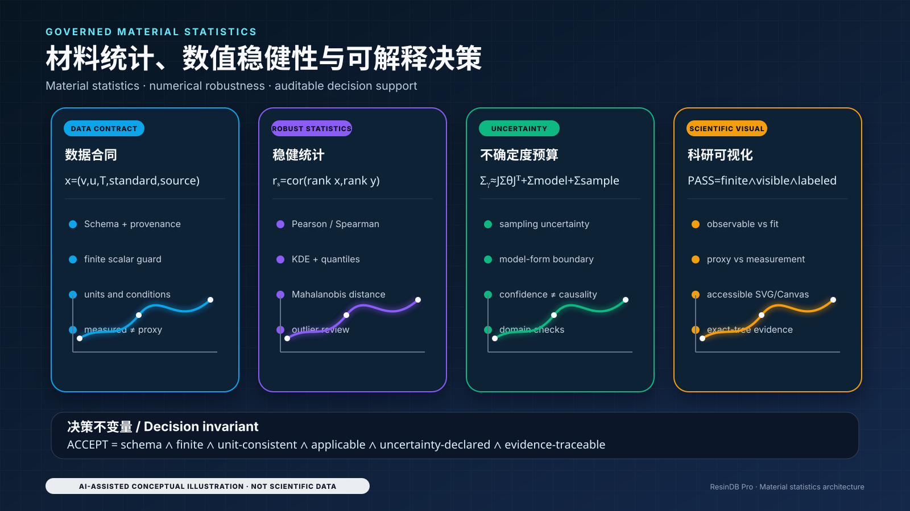

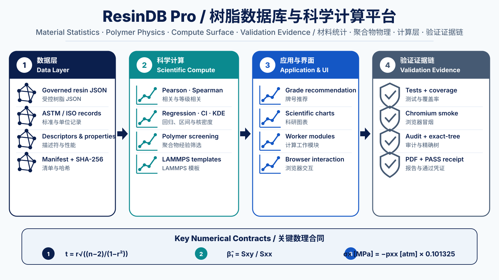

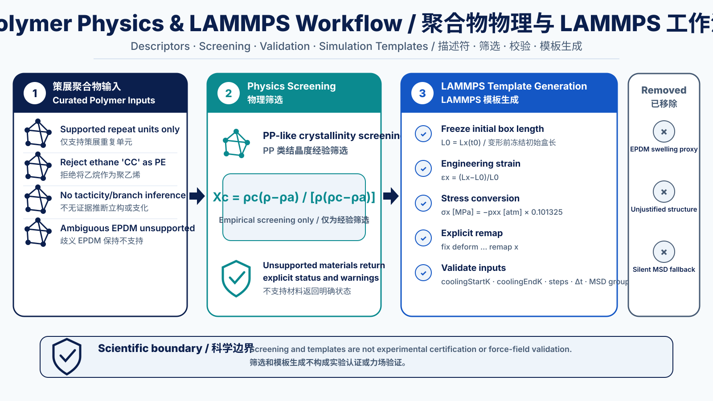

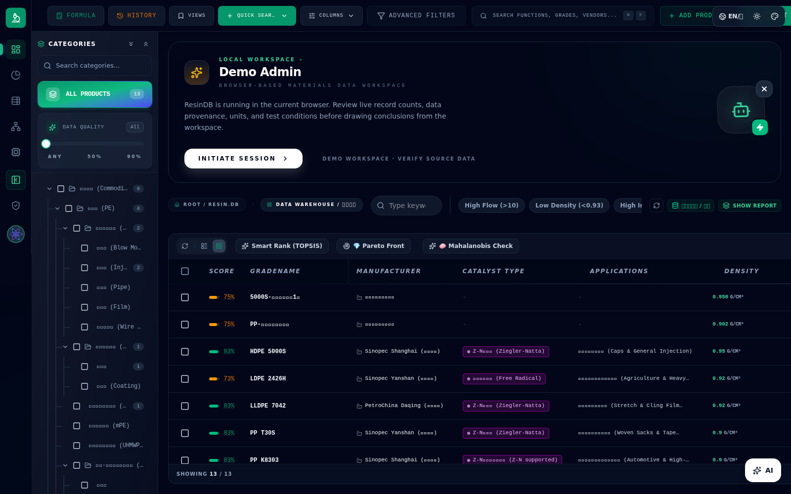

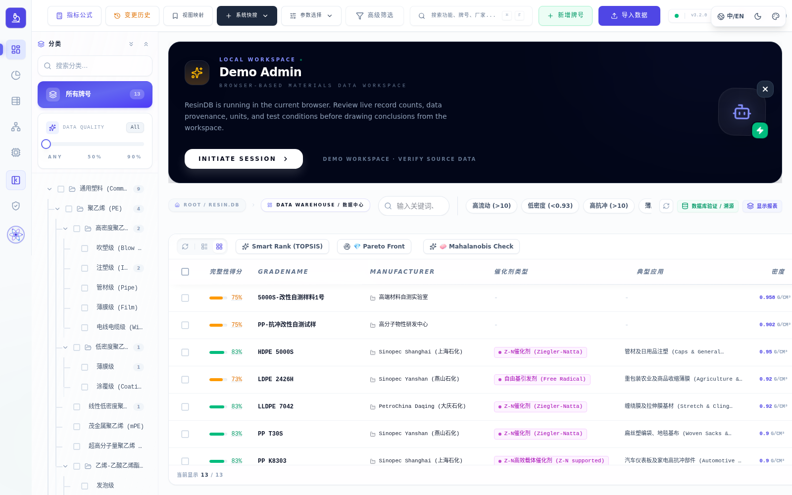

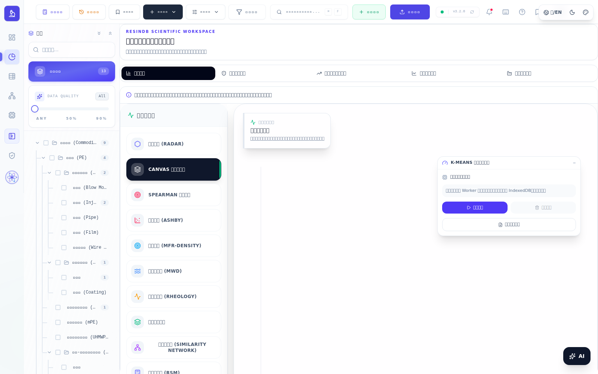

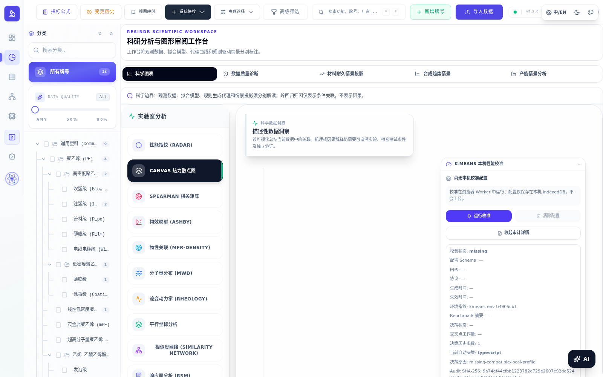

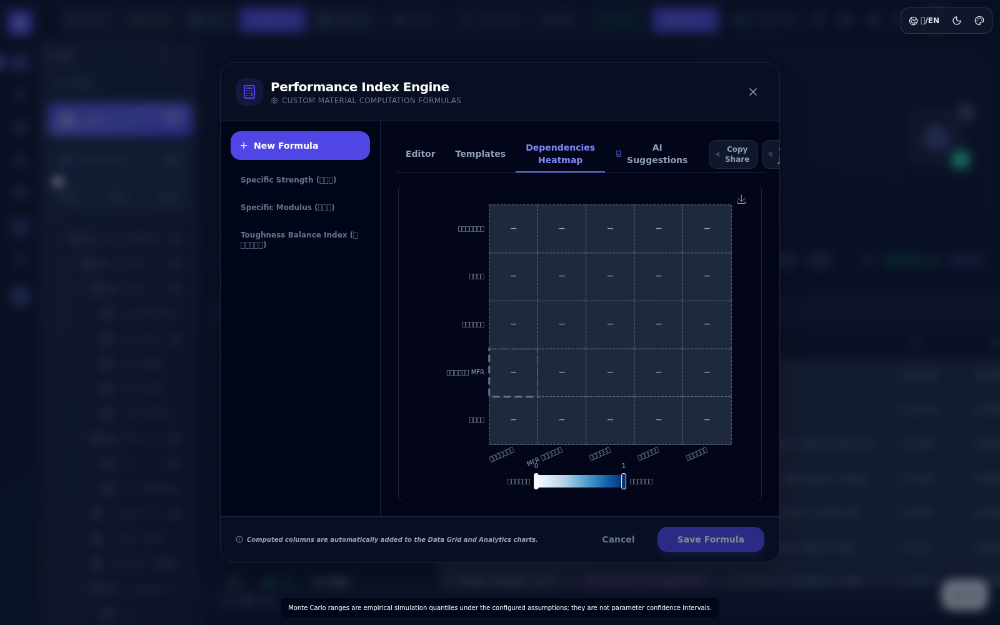

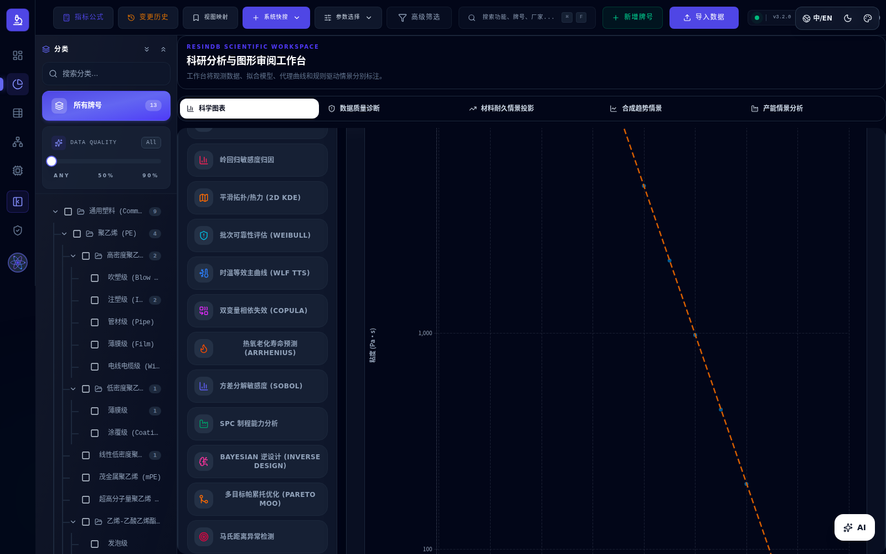

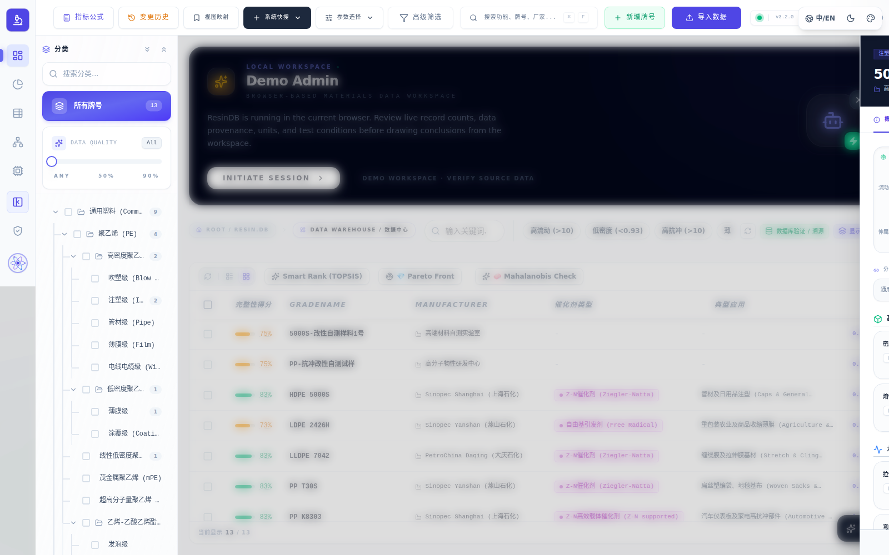

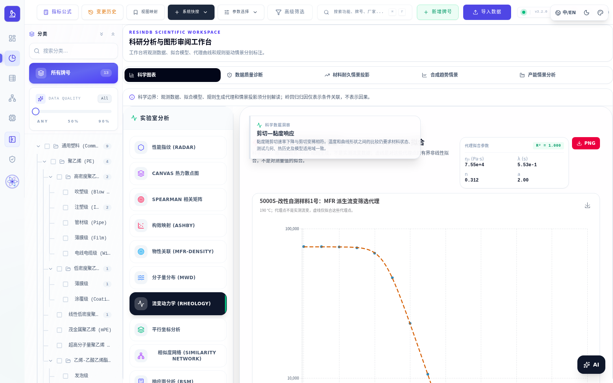
